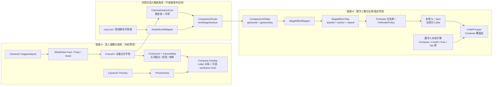

# 相机贴纸与数字人舞台特效：架构与技术选型

> 日期：2026-11-24。用于把「效果资产/运行时」「动画角色引擎」「相机像素管线」分开讨论。相机处理约束仍以 camera-fx 文档为准：设备内存处理，不上传、不落盘。

## 一句话结论

当前特效**不是“整个产品都等于 Lottie”**。相机贴纸与数字人舞台叠加层目前使用仓库自制的 Lottie JSON，通过 Lottie Compose 播放；效果触发、锚点、相机感知、数字人本体渲染是独立层。项目里另有 Compose 分层立绘、Live2D/Duix/Tao 等数字人引擎实验。Rive 曾在数字人 2D 引擎选型文档中被比较，但当前 Gradle 依赖、实际渲染代码和 camera-fx / 舞台特效实现中都没有 Rive demo。

## 两条效果链路

### A. 真人相机贴纸

1. CameraX Preview 显示预览，ImageAnalysis 把本机帧交给 MediaPipe。
2. `FrameFx` 提供人脸、姿态、手关键点。`FxAnchors` / `CanvasMap` 转成预览画布坐标。
3. Compose 叠加层根据头顶锚点摆放本地 Lottie 贴纸；线框/HUD 是独立的 Compose Canvas 绘制。
4. 关闭页面即停止分析与释放模型。这个 UI overlay 只画在本机页面上：当前没有录制、也没有送进 LiveKit 对端视频轨。

代码位置：[`CameraFxGrantedContent.kt`](../../../feature-camera-fx/src/main/java/com/openapi/feature/camerafx/CameraFxGrantedContent.kt)、[`CameraStickerPlacement.kt`](../../../feature-camera-fx/src/main/java/com/openapi/feature/camerafx/CameraStickerPlacement.kt)。

### B. 数字人舞台效果

1. 相机手势或既有 `cmp.cue` 进入统一的 gesture 路径；相机手势先经过稳定帧和冷却判断。
2. `CompanionUiState.gestureId/gestureSeq` 被 `StageEffectMapper` 映射成 `StageEffect.Play(assetId, anchor, repeat)`。
3. `FxAssets` 白名单和 `FxRenderPolicy` 决定可播放效果与降级策略；`LottieFxLayer` 在数字人本体画面上方播放本地动画。
4. 舞台效果的 anchor 是舞台 viewport 坐标（HEAD/BODY/HAND/FULL），不是真人相机的人脸 landmark 坐标。

代码位置：[`StageEffect.kt`](../../../feature-companion/src/main/java/com/openapi/feature/companion/fx/StageEffect.kt)、[`LottieFxLayer.kt`](../../../feature-companion/src/main/java/com/openapi/feature/companion/fx/LottieFxLayer.kt)。

## “我们的特效就是 Lottie 吗？”

当前 `fx_pat_head` / `fx_wave` / `fx_connected` 等**视觉动画资产**是 Lottie JSON；Lottie 是现在的播放后端之一。特效系统还包含：语义 cue、gesture 映射、播放策略、锚点与尺寸、白名单、降级/无障碍策略、生命周期。将来可以在 `LottieFxLayer` 背后换一种 renderer，但不应把事件词表、相机定位、数字人引擎和绘制后端捆成一个库。

“全屏特效”是 Compose 舞台 overlay 的布局语义（anchor=FULL），不是一个新的渲染引擎，也不是三维场景。

## 选型时分成四类

| 类别 | 例子 | 解决的问题 | 对两条链路的关系 |
|---|---|---|---|
| 矢量 / 交互动画播放 runtime | Lottie、Rive | 播放设计师制作的动效；状态机/数据绑定能力因 runtime 而异 | 可替换相机贴纸或舞台 overlay 的资产播放器；Rive 不自动提供相机追踪或视频录制合成 |
| 2D 骨骼角色 runtime | Spine、Live2D、DragonBones | 变形骨骼、网格、角色状态与换装 | 更适合作为数字人“本体”引擎；不是 Lottie JSON 播放器，也不是相机特效管线 |
| 实时渲染 API / 引擎 | OpenGL ES、Vulkan、AGSL、Three.js、PixiJS、游戏引擎 | shader、纹理、三维场景、粒子、渲染循环 | OpenGL/Vulkan 是底层 API；Three/Pixi 是 JS 引擎，Android 常经 WebView；它们都不自带人脸跟踪与 cue 语义 |
| 相机像素合成管线 | CameraX `OverlayEffect` / `SurfaceProcessor` | 把效果实际合入预览、录制或图像输出帧 | 只有需要“录下来/发给对端也带效果”才需要；当前仅 Compose 屏幕 overlay 不需要 |

## 这轮初步判定

- **继续用 Lottie 播放当前相机贴纸和舞台动效**，因为现有两条链路已经接好。此前贴纸过小是像素换算 bug，已修；更换库不能代替真机验证。
- **Rive**：曾被纳入数字人角色运行时选型，但仓库当前没有 Rive 依赖或 demo。它更适合需要状态机、交互和骨骼变形的动画/角色资产；需要重新制作或迁移资产。关于 Android 离屏纹理输出，本轮未找到官方 runtime API 证据，所以不把它作为“可直接 bake 相机录制”的理由。
- **Spine / Live2D / DragonBones**：评估数字人角色本体时再比较；它们解决骨骼角色动画，不是 camera sticker overlay 的直接替代。Spine 的编辑器/运行时商业许可要单独核算；Live2D 许可需按产品模型确认；DragonBones 要关注项目维护状态。
- **OpenGL ES / Vulkan**：适合自研渲染器或 CameraX `SurfaceProcessor`，但需要自行承担生命周期、纹理同步、坐标/旋转、帧延迟、GPU 兼容性。它们是底层能力，不是“拿来就能播 Lottie”的组件。
- **Three.js / PixiJS**：若整个角色产品本来就是 Web/游戏渲染，才考虑；嵌进现有 Compose 通话页会额外引入 WebView/WebGL 边界。Three.js 主要是 3D 场景；PixiJS 主要是 2D/WebGL。
- **AGSL / RuntimeShader**：像素级 shader 效果，不负责骨骼或动效素材；RuntimeShader 起步 API 33，而 app minSdk 28，需要旧系统回退。
- **录制/对端可见**：再评估 `androidx.camera:camera-effects` 的 `OverlayEffect`，它可以用 Canvas overlay，并配置 PREVIEW / VIDEO_CAPTURE targets；对 LiveKit 本地视频轨仍需先解决实际采集接入。

## 候选库逐项核查（2026-11-24）

「最新 release」指该仓库正式打过 tag/release 的最近日期；有些项目只滚动提交，不打 release。
标 **未确认** 的是本轮只查到「活跃」但没查到可靠日期或条款的项，按存疑处理而不是推断。

| 候选 | 活跃 / 最新 release | 许可 | Android 接入 | 资产工作流 / 能否吃现有 Lottie JSON | 对两条链路的适配 |
|---|---|---|---|---|---|
| [Lottie Android](https://github.com/airbnb/lottie-android)（我们在用 6.7.1） | 本项目 Maven metadata 记 latest 6.7.1（2026-11-11）；GitHub surfaced tag 6.6.10（2025-10-02），tag 与 Maven release 节奏不同 | Apache-2.0 | 原生 Android / Compose | AE + Bodymovin；原生 Lottie JSON | 两条链路现状即它。跟踪与锚点始终是我们自己的责任 |
| [Rive Android](https://github.com/rive-app/rive-android) | release 持续；**最新日期未确认** | 运行时 MIT；**编辑器/资产条款另算** | 原生 runtime（Compose API beta） | Rive 编辑器 `.riv`；**不吃 Lottie JSON** | 舞台侧状态机/交互最强；相机侧要我们自己喂 landmark。资产要重做 |
| [Spine runtimes](https://github.com/EsotericSoftware/spine-runtimes) | 无正式 GitHub release；4.3 分支 2025-04 更新 | **Spine Runtime License，非 OSI 开源**；再分发需 Spine 授权；无免费编辑器档 | 原生 Java/Android | Spine 编辑器 + skeleton/atlas；**不吃 Lottie** | 数字人本体（骨骼/网格/IK/skin 换装）最优；骨骼化相机贴纸技术上可做（跟随 landmark 播骨骼动画），本 demo 不纳入的原因是编辑器资产与授权核算，不是技术不适合 |
| [libpag（腾讯）](https://github.com/Tencent/libpag) | release 活跃到 2026；已发 Android AAR；**最新日期未确认** | Apache-2.0；本轮未能从官方仓库页面核实预编译 AAR 是否含 Beacon 遥测 | 原生 SDK / AAR | AE + PAG 导出插件；自有格式，**不吃 Lottie JSON** | 舞台/相机叠加层都是「播 AE 动效」的候选。引入前需检查实际 AAR 的网络/遥测行为，确保符合不上传边界 |
| [Skia Skottie](https://github.com/google/skia/tree/main/modules/skottie) | 随 Skia 滚动，无独立 release | Skia BSD-style | 经 Skia Android，通常要 NDK/自建集成，不是即插即用 Compose 依赖 | AE + Bodymovin；**Lottie JSON 的子集**，兼容性不如 Airbnb runtime | 想统一到一个 C++ 渲染栈时有用；特效语义仍自己写 |
| [rlottie](https://github.com/Samsung/rlottie) | v0.2；**仓库自述已弃用/归档** | MIT | C++ NDK/JNI | Bodymovin Lottie JSON | 新项目不选（归档） |
| [Effekseer](https://github.com/effekseer/Effekseer) | 活跃；**最新日期未确认** | 主项目 MIT；**DirectX runtime 另有许可**（Android 走 GLES 不涉及） | C++ runtime 支持 Android，需 NDK/backend | Effekseer 编辑器 `.efk`；**不吃 Lottie** | 粒子/VFX 最强项：贴合 tracked 粒子和事件爆发。但要自带渲染 backend |
| [PixiJS](https://github.com/pixijs/pixijs) + [pixi-filters](https://github.com/pixijs/filters) | PixiJS 8.21.0（2025-09-17）；filters **未确认** | MIT | **仅 Web**，Android 需 WebView | 代码/Canvas/SVG/贴图；filters 是 shader 特效；默认不吃 Lottie | 2D WebGL 精灵+滤镜强，但要在通话页里塞 WebView/WebGL 子系统。pixi-spine 有版本相关 Spine 许可问题，v8 fork 已归档 |
| [Three.js](https://github.com/mrdoob/three.js) | 滚动 release；**当前版本未确认** | MIT | WebView（WebGL/WebGPU）；原生要另接 renderer | Blender/GLTF；不吃 Lottie | 真 3D 才考虑。仓库已有 VRM = WebView + three.js，**lab 实验田不进生产** |
| [tsParticles](https://github.com/tsparticles/tsparticles) | 活跃；**具体日期未确认** | MIT | 仅 Web | JSON/config | 氛围粒子容易做，代价是 Web 容器 |
| [GSAP](https://github.com/greensock/GSAP) | 活跃；**日期未确认** | GSAP Standard License；Webflow 2025-04-30 宣布免费含商用，**免费含商用 ≠ OSI 开源**，**分发时要核实际包许可** | 仅 Web | 代码时间轴；不吃 Lottie | 是编排层不是渲染器，单独当特效 runtime 不成立 |
| [Motion Canvas](https://github.com/motion-canvas/motion-canvas) | 3.18.0-alpha.0（2025-02-16），节奏偏低 | MIT | Web 创作/渲染，**不是 Android runtime** | TS 场景代码，导出视频/帧 | 做解释动画可以，做实时运行层不行 |
| [Phaser](https://github.com/phaserjs/phaser) | v3.90.0（2025-05-23） | MIT | Web（WebView） | 代码/图集 | 游戏引擎开销换粒子+交互场景，对本项目不划算 |
| DragonBones（[官方 org](https://github.com/DragonBones)） | **不能一概称「已弃用」**：DragonBonesJS 2026-01、C# 2026-05 有活动；旧 ActionScript/示例停在 2019 | MIT | 具体 runtime 各自核对 | 类 Spine 骨骼工作流 | 采用前必须逐个 runtime 核维护状态与编辑器支持 |
| AGSL `RuntimeShader` | 平台 API（非库） | Android 平台 | **API 33 起**，minSdk 28 要回退 | 手写 shader，无资产系统 | 小范围像素/post-process 效果 |
| OpenGL ES / Vulkan | 平台 API | — | 原生图形 API | 无导入器、无编辑器 | 合成自由度最高、工程成本最高（渲染循环、坐标变换、生命周期、纹理同步）；Vulkan 对这个用例过重 |
| LottieFiles 生态 | — | 逐项资产各自许可 | 运行时仍是 Airbnb Lottie | 创作/发现/优化 | 不是替代 renderer；资产许可要单独核 |

**一处纠正**：核查报告给的 Lottie 最新 release 是 6.6.10（2025-10-02），但本仓库 Maven metadata 在 2026-11-11 实测 latest = **6.7.1**（见 [avatar-2d-design.md 第 60 条](../../avatar-2d-design.md)），与我们 `feature-camera-fx/build.gradle` 里的版本一致。以实测 metadata 为准。另注：Lottie 生态的 Android 运行时不止 Airbnb 一家（Skottie、rlottie 也播 Lottie JSON），dotLottie 也有其他 runtime 实现——「Lottie 运行时只有 Airbnb」的说法不准确。

## 按类别的取舍（不是排名）

- **不动**：Lottie。两条链路已经接好，`LottieFxLayer` 后面换 renderer 是局部改动，词表/锚点/感知都不用动。
- **舞台侧若要更强的交互**：在交互动效这一档里，Rive 的状态机工具链最顺手（状态机 + 数据绑定 + 原生 Android）；Spine 运行时也有状态机与 skin/attachment 切换（商业授权另算）。代价是 `.riv` 资产重做 + 编辑器订阅。
- **粒子/VFX 若要真做**：Effekseer 比 Lottie 合适（Lottie 不是粒子引擎），代价是 NDK backend。这和现有 `FxCategory.AMBIENCE` / `particles` 开关正好对得上。
- **AE 管线保真度**：libpag 是 Apache-2.0 候选；其 Android 预编译 AAR 是否含遥测本轮未能从官方仓库页面证实。若要评估，应先检查实际 AAR 的网络行为与源码构建路径，再确认是否满足「不上传」边界。
- **数字人本体**：Spine / Live2D 走 [avatar-2d-design.md](../../avatar-2d-design.md) 的 P0/P1 判定，不在特效层解决。
- **Web 系（Three/Pixi/GSAP/Phaser/tsParticles/Motion Canvas）**：都要 WebView 子系统，除非产品本身转 Web/游戏渲染。
- **录制/对端可见**：`androidx.camera:camera-effects` 的 `OverlayEffect`（Canvas overlay + PREVIEW/VIDEO_CAPTURE targets），不是换动画库能替代的；「LiveKit 出向视频轨今天还不存在」是基于 grep 的判断而非完整架构审计，保留为**未验证**，先补采集。

**共性提醒**：没有任何一个候选自带人脸跟踪。检测、平滑、镜像/旋转、遮挡、anchor→render 映射始终是我们的应用责任；GitHub star 数不等于维护状态；runtime 许可 ≠ 编辑器许可 ≠ 美术资产许可。
